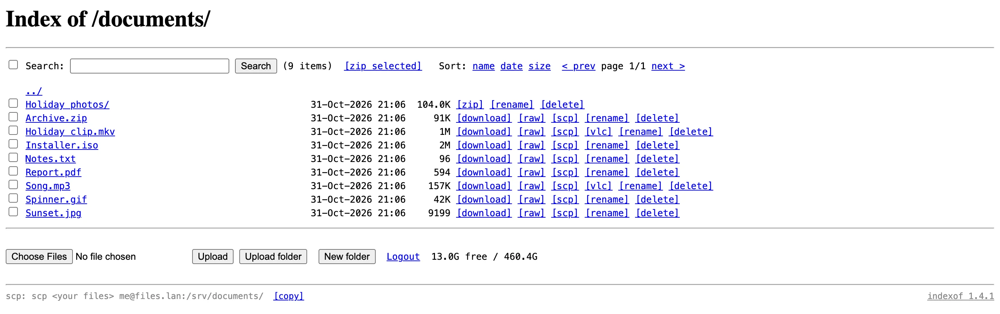
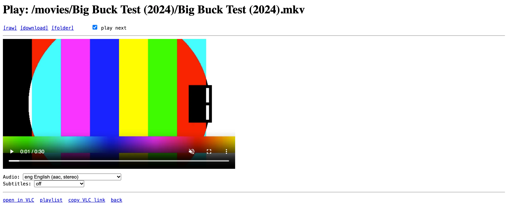

<h1 align="center">indexof</h1>

<p align="center">
  <strong>A plain file server for your home: nginx's "Index of /" with the few things it was missing. Self-hosted, no frills.</strong><br>
  The household's shared drive, from any browser: browse, upload, download, search, zip, rename, organise. Videos and music play too. Two small containers, two secrets, any folders you mount.
</p>

<p align="center">
  <a href="https://github.com/lborruto/indexof/actions/workflows/ci.yml"></a>
  <a href="LICENSE"></a>
</p>

<p align="center">
  
</p>

## What it does

- **Your folders, from any browser.** Documents, photos, backups, the things you share at home:
  mount any folders under `/data` and they are there, on the computer or the phone, with nothing
  to install. It is nginx's own "Index of /", unchanged in look, with sizes and dates.
- **Upload, download, organise.** Upload from the browser (several files, three at a time, each
  with its %, time left and `[cancel]`), make folders, `[rename]` or move, `[delete]`, in the
  folders you mount writable; drop files on the page to upload them; tick lines to zip, move or
  delete them together. `[download]` on every file; `[raw]` opens it in the browser as the
  server sends it. Prefer the terminal? Set
  `INDEXOF_SCP` and the page shows the `scp` line for the folder you are in, ready to copy.
- **Find things.** A live filter on the folder you are in, and Search across all of them: text,
  folder, files or folders, kind (documents, pictures, videos, archives…). Sort by name, date or
  size; pages of 100; each folder's size filled in as you look; the disk's free space (on the
  home page too, once per disk).
- **Zip and take away.** `[zip]` on any folder, or tick some lines and "zip selected". The
  archive is streamed as it is made, nothing is written on the server.
- **Read-only where you want it.** A folder mounted `:ro` can be browsed, searched, downloaded
  and zipped, never changed. A writable one takes uploads and changes. Nothing else to
  configure.
- **Videos, music, pictures and text too.** A click on the name opens them in the browser as
  they are, never converted, with the audio track and subtitles from inside the file. ← and →
  go through the folder, music and episodes play on into the next file, and a video starts again
  where you stopped. Notes, logs, subtitles and code are shown as text, a PDF opens in the
  browser's reader, anything else (a zip, an ISO…) downloads. What the browser cannot play opens
  in VLC with one click (`[vlc]`).
- **One password, no accounts.** Everyone in the household uses the same password; a login
  holds 30 days.
- **Two small containers.** nginx (the unprivileged image) for the pages and the files, and a
  helper (busybox httpd, zip, ffmpeg) for sizes, search, zips and the player, on an internal
  network only nginx can reach. `linux/amd64` and `linux/arm64`. No database, no framework, no
  build step.

## Security

Read this before you install. indexof is a plain file server for a home network; it is
exactly as safe as the network it sits on.

- **Never expose it to the internet.** No port forwarding, no public host name, not even for an
  afternoon. Reach it from the home network, and from outside through a VPN (Tailscale,
  WireGuard…).
- **It speaks plain HTTP.** The password, the login cookie and every file travel in clear. On
  your own network or inside the VPN that is fine: the VPN is what protects the password.
  Anywhere else, it is not. A reverse proxy you control can add TLS in front; keep the VPN
  anyway.
- **A long random password, and a separate link key.** `openssl rand -hex 32` for each. Whoever
  has the password can do everything the server allows, and there is no rate limit on the login,
  so it must be long and random. `INDEXOF_LINK_SECRET` signs the VLC links: its own value, 32
  characters or more, never the password.
- **Mount `:ro` what should only be browsed.** A read-only folder can be listed, searched,
  zipped, played and downloaded, never changed, whatever anyone does with the password. A
  mounted folder itself is never renamed, moved or deleted, whatever its mode.
- **A VLC link is a key to one file.** "Open in VLC", the playlist and "copy VLC link" carry a
  link that works without the password, for that file only, read-only, for 12 hours. Whoever
  holds it can download that file until then: share it as you would share the file.
- **Published on this machine only by default** (`127.0.0.1:8099`). `INDEXOF_BIND` opens it to
  your network, on purpose, and only then.

What is protected and what is not, in full: [SECURITY.md › Security model](SECURITY.md#security-model).
Found a vulnerability? [Report it privately](SECURITY.md#reporting-a-vulnerability).

## Get started

**You need:** Docker with Compose v2 (amd64 or arm64), the folders you want to share, and a
network nobody else is on: your home network, plus a VPN to reach it from outside.

Make a folder for indexof with these two files in it. `compose.yaml`:

```yaml
# indexof: nginx's "Index of /" for the folders you mount under /data, and its helper (sizes,
# search, zips, the player's tracks, VLC links) on an internal network. The two secrets come
# from .env next to this file. The page is on http://127.0.0.1:8099.

x-logging: &logging
  driver: json-file
  options:
    max-size: 20m
    max-file: "3"

services:
  indexof:
    image: ghcr.io/lborruto/indexof:latest # pin a version (…:1.1.0) for a setup that changes only when you say so
    restart: unless-stopped
    user: "${PUID:-1000}:${PGID:-1000}" # the owner of the folders below (id -u, id -g)
    environment:
      INDEXOF_PASSWORD: "${INDEXOF_PASSWORD:?set INDEXOF_PASSWORD in .env (the page's password)}"
      INDEXOF_LINK_SECRET: "${INDEXOF_LINK_SECRET:?set INDEXOF_LINK_SECRET in .env (32 characters or more: openssl rand -hex 32)}"
      INDEXOF_SCP: "${INDEXOF_SCP:-}"
      INDEXOF_SCP_ROOT: "${INDEXOF_SCP_ROOT:-}"
    volumes:
      - ./data/share:/data/share # writable: uploads, new folders, rename, move, delete
      # - /srv/photos:/data/photos:ro # read-only: browse, search, zip, download
    ports:
      - "${INDEXOF_BIND:-127.0.0.1}:${INDEXOF_PORT:-8099}:8080"
    networks: [default, indexof]
    depends_on: [indexof-helper]
    logging: *logging

  indexof-helper:
    image: ghcr.io/lborruto/indexof-helper:latest # the same version as the page's
    restart: unless-stopped
    user: "${PUID:-1000}:${PGID:-1000}"
    environment:
      INDEXOF_LINK_SECRET: "${INDEXOF_LINK_SECRET:?set INDEXOF_LINK_SECRET in .env (32 characters or more: openssl rand -hex 32)}"
    volumes:
      # The same folders, always read-only: the helper only reads.
      - ./data/share:/data/share:ro
      # - /srv/photos:/data/photos:ro
    networks: [indexof]
    logging: *logging

networks:
  # The helper is reached by the page only: this network has no way out, and nothing publishes it.
  indexof:
    internal: true
```

And `.env`, with the two secrets (every other setting has a default; the full list is
[below](#configuration-reference)). Generate both; the password is what you will type on the
login page, so keep it in your password manager:

```bash
echo "INDEXOF_PASSWORD=$(openssl rand -hex 32)"    >  .env
echo "INDEXOF_LINK_SECRET=$(openssl rand -hex 32)" >> .env
docker compose up -d
```

1. **Open** http://127.0.0.1:8099 on the machine that runs it and **log in** with
   `INDEXOF_PASSWORD`. The home page lists your folders: `share`, writable, to begin with.
2. **Mount your folders.** Add each one under `/data` in *both* services (the helper's copy
   always `:ro`), `:ro` on the page's side for the ones that should only be browsed, then
   `docker compose up -d` again. See [Folders](#folders).
3. **Reach it from your other devices.** In `.env`, set `INDEXOF_BIND` to this machine's address
   on your network (`192.168.1.10`, say) or `0.0.0.0`, and `INDEXOF_PORT` if 8099 is taken, then
   `docker compose up -d`. Only on your home network or your VPN: read [Security](#security)
   first.
4. **Play in VLC.** Install the VLC Link helper once per computer, so that `[vlc]` opens VLC.
   See [Open in VLC](#open-in-vlc).

**Just looking?** The repository's demo makes a folder of invented movies (several audio
tracks, subtitles), music, pictures and files with awkward names: nothing real, so it is safe to
show. Point the compose file at it and run it on its own port and project name, so it never
touches a real install:

```bash
git clone https://github.com/lborruto/indexof.git && cd indexof
sh tests/make-demo.sh demo        # needs Docker: the videos are made by ffmpeg in the helper image
echo "INDEXOF_PASSWORD=$(openssl rand -hex 32)"    >  .env
echo "INDEXOF_LINK_SECRET=$(openssl rand -hex 32)" >> .env
```

In `compose.yaml`, mount `./demo/movies:/data/movies:ro`, `./demo/music:/data/music:ro`,
`./demo/pictures:/data/pictures:ro`, `./demo/share:/data/share` and
`./demo/documents:/data/documents` (the same five, all `:ro`, in the helper), then:

```bash
INDEXOF_PORT=8098 COMPOSE_PROJECT_NAME=indexof-demo docker compose up -d
```

Open http://127.0.0.1:8098 and log in with the password from `.env`. Remove it with the same
variables and `docker compose down`.

## Folders

- **Anything under `/data`.** Each folder you mount becomes one entry on the home page, with its
  name in the container (`/srv/photos:/data/photos:ro` shows as `photos`). Mount it in both
  services: the page serves it, the helper (always `:ro`) measures, searches and zips it.
- **`:ro` means browse-only.** nginx refuses every write on it, and the kernel would refuse
  anyway. Without `:ro`, the folder takes uploads, new folders, rename, move and delete, and
  gets a hidden `.uploads` folder where uploads arrive before they are moved into place (same
  disk, so finishing an upload is a rename).
- **The folder itself is never renamed, moved or deleted**, whatever its mode: that would take
  all of it.
- **Names.** A mounted folder whose name starts with `.` (hidden) or `_` (kept for the page's
  own routes, `/_login`, `/_search`…), or holds a double quote, a backslash or a dollar sign, is
  refused with a line in the log. Everything inside the folders is fine: spaces, accents,
  quotes, `#`, `?`, `%`, `&`, parentheses. Hidden files are never served, symbolic links are not
  followed.
- **Who owns the files.** Both containers run as `PUID`:`PGID` (1000:1000 by default): set them
  to the owner of your folders (`id -u`, `id -g`), so that uploads belong to you and the helper
  can read everything. A folder that is not readable by that user shows up empty.

## Playing media

<p align="center">
  
</p>

indexof never converts anything: the browser gets the file as it is, so what plays is what your
browser can decode. Measured on Chrome 154 on macOS:

| | Plays in the browser | Does not |
|---|---|---|
| **Video** | H.264, HEVC (when the machine's hardware decodes it), VP9, AV1 | |
| **Audio** | AAC, MP3, Opus, FLAC | AC3, E-AC3, DTS: the picture plays without sound. Use VLC. |
| **Subtitles** | Text tracks inside the file (SRT, ASS, SSA…) | Image subtitles (PGS, VobSub) are listed but cannot be shown |

- **Audio tracks.** Chrome plays the first track it can decode, whatever the file calls its
  default; the player shows that one first and marks Dolby and DTS tracks "no sound here".
  Choosing another track uses the browser's own switch when it has one; otherwise the file is
  repackaged on the fly with that track (a copy-only remux, never re-encoded) and the player's
  own play and seek line takes over.
- **Other browsers** have their own lists. Whatever will not play in the browser opens in VLC.
- **Through the folder.** `[← prev]` and `[next →]` (or the arrow keys) go to the folder's
  previous and next file of the same kind: picture to picture, song to song, episode to episode.
  With **play next** ticked (the default), music and videos go on into the next file when one
  ends, and stop after the last.
- **Where you stopped.** The browser remembers how far you got in each video and song, and
  starts there next time ("resumed at 42:10", with `[start over]`). It is kept in that browser
  only, nothing on the server.
- **Text files.** Notes, logs, subtitles, `.nfo`, configuration and code open as plain text
  (the first 1 MiB; old Windows encodings are read too). HTML and Markdown are shown as source,
  never run. `[raw]` opens any file as the server sends it, `[download]` saves it.

### Open in VLC

`[vlc]` next to a video or a piece of music, and "open in VLC" in the player, open a
`vlc://` link to the file: a temporary one (that file only, read-only, 12 hours) that VLC can
fetch without the password. Browsers do not know `vlc://`, and VLC does not register it, so
install the small **VLC Link** helper once per computer, giving it the addresses you type to
reach the page (`host:port`, one for each way you reach it); it opens links to those only.

- Mac: `sh vlc-link/mac/install.sh files.lan:8099 192.168.1.10:8099` puts `VLC Link.app` in
  `~/Applications`.
- Windows: `powershell -ExecutionPolicy Bypass -File vlc-link\windows\install-vlc-link.ps1 -Allowed files.lan:8099,192.168.1.10:8099`,
  for your account, no administrator needed.

The first click in Chrome asks whether to open VLC Link: tick **Always allow**. Without the
helper (Linux, a borrowed computer), the player offers **playlist**, an `.m3u` that VLC opens
(in Chrome's downloads, "Always open files of this type" makes it one click), and **copy VLC
link** for VLC's *File › Open Network*. How the helpers work and what they refuse:
[vlc-link/README.md](vlc-link/README.md).

## Configuration reference

Everything is set in `.env` next to `compose.yaml`; the two secrets are required, the rest has a
default.

| Variable | Default | What it does |
|---|---|---|
| `INDEXOF_PASSWORD` | required | The page's password. Long and random (`openssl rand -hex 32`); whoever has it can do everything the server allows. |
| `INDEXOF_LINK_SECRET` | required | Signs the temporary VLC links. 32 characters or more, random (`openssl rand -hex 32`), never the password. The containers refuse to start without both secrets. |
| `INDEXOF_BIND` | `127.0.0.1` | The address the page is published on: this machine only by default. Your LAN address or `0.0.0.0` opens it to the network the machine is on. |
| `INDEXOF_PORT` | `8099` | The port on that address. |
| `PUID` / `PGID` | `1000` / `1000` | The user and group both containers run as: the owner of the folders you mount (`id -u`, `id -g`). |
| `INDEXOF_SCP` | empty | Optional: the ssh destination of the machine the folders are on (`user@files.lan`, as you would type it after `scp`). Set, it shows an `scp` line next to Upload, with `[copy]` and `[copy destination]`; empty, no line. |
| `INDEXOF_SCP_ROOT` | empty | Optional, for that line: the folder on that machine that holds the mounted folders under their names (`/srv` when `/srv/share` is mounted as `/data/share`), so the line says `/srv/share`; empty, it says the container's own `/data/share`. |

The folders are the `volumes:` of the compose file ([Folders](#folders)); `restart`, the log
limits and the internal network are set there too.

## Upgrading

```bash
docker compose pull && docker compose up -d
```

What changed is in [CHANGELOG.md](CHANGELOG.md). With `:latest`, that is what you get at the
next pull; pin a version (`ghcr.io/lborruto/indexof:1.1.0` and the same for the helper) for a
setup that only changes when you say so. There is no data of indexof's own to migrate: your
files stay yours, where they are.

## Help and docs

| I want to… | Read |
|---|---|
| Know what indexof protects and what it does not | [SECURITY.md](SECURITY.md) |
| Report a vulnerability, privately | [SECURITY.md › Reporting](SECURITY.md#reporting-a-vulnerability) |
| Make `[vlc]` open VLC on my computer | [vlc-link/README.md](vlc-link/README.md) |
| Hack on indexof, run the demo and the tests, see how it works | [CONTRIBUTING.md](CONTRIBUTING.md) |
| See what changed in each version | [CHANGELOG.md](CHANGELOG.md) |
| Join in respectfully | [CODE_OF_CONDUCT.md](CODE_OF_CONDUCT.md) |

Found a bug? [Open an issue](https://github.com/lborruto/indexof/issues) with the version (the
image tag) and the steps, never your addresses, password or real file names. The demo data
(`tests/make-demo.sh`) exists so you can show one.

## Licence

MIT, see [LICENSE](LICENSE). The images bundle nginx, ffmpeg and Info-ZIP, each under its own
licence; the VLC Link helpers only hand links to the VLC you installed yourself.

## Not affiliated, no warranty

indexof is an independent project. It is not made, endorsed or supported by NGINX (F5),
VideoLAN, FFmpeg or Docker; nginx, VLC, FFmpeg, Docker, Tailscale and WireGuard are trademarks
of their respective owners, named here only to say what indexof works with. It serves your
files as they are, with no warranty of any kind: read [Security](#security), keep it on your
home network, and keep your backups.
